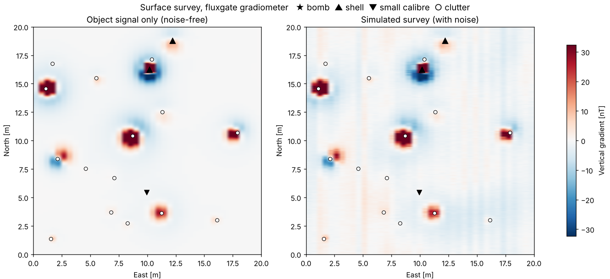
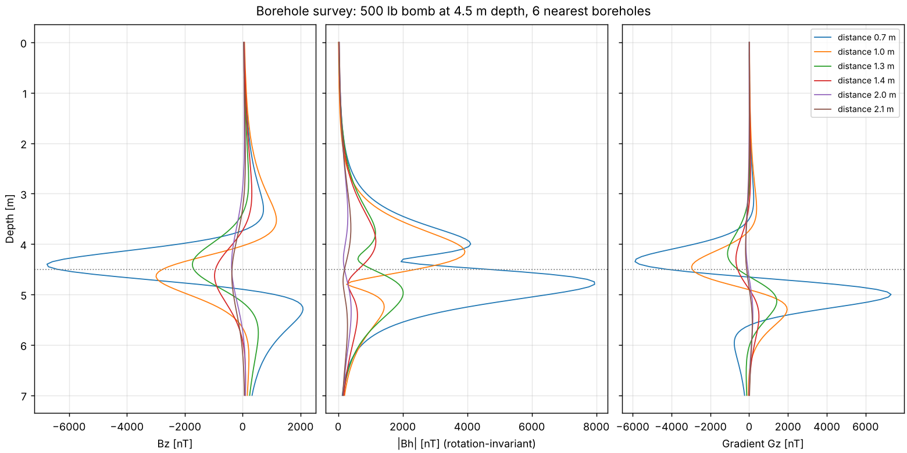

# uxo-detection-pipeline

**Open-source pipeline for unexploded ordnance (UXO) detection and classification from geophysical survey data.**
Synthetic magnetometry simulator (surface & borehole), preprocessing, target picking, and ML/DL classification of UXO vs. clutter.

[](https://github.com/HerrKnecht/uxo-detection-pipeline/actions/workflows/tests.yml)
[](LICENSE)




## Why

Every year, World War II bombs and shells are found on construction sites in Germany and across Europe.
Before construction starts, sites are surveyed with magnetometers (surface and borehole), electromagnetic
induction (EM) and ground-penetrating radar (GPR). Picking anomalies and deciding *ordnance or scrap?* is
still largely manual and depends on expert experience. Most digs turn out to be scrap.

This project explores where automation makes sense, comparing **physics-based inversion**,
**classical machine learning** and **deep learning**, and is honest about the hard parts:
missed UXO is unacceptable, real labelled data is scarce, and models trained on synthetic data
must survive real-world noise.

Since real survey data is rarely public, the project starts with a **synthetic data simulator**:
every simulated survey comes with full ground truth (position, depth, type), which is ideal for
training and fair evaluation.

## Status

| Phase | Content | Status |
|---|---|---|
| 1 | Simulator: dipole model, object catalogue, noise, surface + borehole | ✅ v0.1.0 |
| 2 | Preprocessing: destriping, background removal, drift correction | planned |
| 3 | Target picking: threshold baseline, clustering, CNN | planned |
| 4 | Classification: dipole inversion, random forest / XGBoost, CNN | planned |
| 5 | Extensions: public field data (ESTCP), EM (SimPEG), GPR (gprMax), LLM-assisted reporting | later |

## Quick start

```bash
git clone https://github.com/HerrKnecht/uxo-detection-pipeline.git
cd uxo-detection-pipeline
python -m venv .venv && source .venv/bin/activate   # Windows: .venv\Scripts\activate
pip install -e ".[dev]"

pytest                                   # physics tests
python scripts/demo_plots.py             # example figures -> docs/img/
python scripts/generate_dataset.py --out data/v1 --n-surface 200 --n-borehole 50 --seed 42
```

Minimal example:

```python
import numpy as np
from uxo_pipeline.simulation import random_scene, simulate_surface, SurfaceNoise

rng = np.random.default_rng(0)
scene = random_scene(rng, x_range=(0, 20), y_range=(0, 20), n_uxo=2, n_clutter=10)
result = simulate_surface(scene, noise=SurfaceNoise.random(rng), rng=rng)

result.data          # (ny, nx) vertical gradient [nT] with realistic noise
scene.targets        # ground truth: type, position, depth, magnetic moment
```

## What the simulator covers

**Objects:** aircraft bombs (250 / 500 / 1000 lb), artillery shells (75–150 mm), 81 mm mortar,
20 mm projectiles, and clutter (fragments, small/large scrap, pipes/rebar). Each object has random
orientation, depth, magnetic susceptibility and remanence.

**Surveys**
- *Surface:* fluxgate vertical gradiometer (default) or total-field magnetometer, configurable line spacing,
  sensor height and gradiometer base.
- *Borehole:* boreholes on a grid (default 1.5 m, 7 m deep), channels Bz, rotation-invariant |Bh| and
  vertical gradient; profiles are truncated if a borehole would hit an object.

**Noise:** sensor noise, line offsets / heading error, magnetic soil (correlated random field),
GNSS position error, sensor height variation, probe drift.



## Physical model and its limits

Each object is a steel spheroid acting as a point dipole. Its moment is the sum of
- an **induced** part, depending on shape and orientation relative to the Earth's field
  (via demagnetisation factors: elongated objects magnetise preferentially along their axis), and
- a **remanent** part with random direction and strength relative to the induced part
  (stronger for clutter than for ordnance).

Known simplifications (contributions welcome):
- Point-dipole approximation; inaccurate in the near field (< ~2× object length, especially in boreholes).
- Hollow bodies are treated as solid.
- Object dimensions are rounded indicative values and should be checked against technical references.
- Soil is a statistical random field, not a geological model.

## Conventions

- Internal coordinates: **x = East, y = North, z = Up**, z = 0 at ground surface; object depth is positive downward.
- Values in **nT**. Vertical component and gradient use the **geomagnetic convention (Z positive downward)**:
  an induced-magnetised object in the northern hemisphere produces a positive peak with a negative lobe to the north.
- Gradient = lower sensor − upper sensor.

## Project structure

```
src/uxo_pipeline/
  simulation/
    physics.py     Earth field, dipole field, induced moment (spheroid + demagnetisation)
    objects.py     object catalogue (bombs, shells, 20 mm, clutter) and random scenes
    noise.py       disturbances: noise, line offsets, soil, GNSS, height, drift
    surface.py     surface survey (fluxgate gradiometer or total field)
    borehole.py    borehole survey (Bz, |Bh|, Gz; collision check)
  processing/      preprocessing (phase 2)
  detection/       target picking (phase 3)
  classification/  UXO vs. clutter (phase 4)
scripts/           dataset generator, demo plots
tests/             physics tests (analytical limits, plausibility)
notebooks/         experiments
data/              generated data (not in git, reproducible via seed)
```

## Related work and resources

- Heagy et al. (2020): CNNs for classifying UXO from EM data – [repo](https://github.com/simpeg-research/heagy-et-al-2020-uxo-seg)
- McGinnity, Kolster & Døssing (2024): automated target picking in magnetic UXO surveys, *Remote Sensing* 16, 507
- [SimPEG](https://simpeg.xyz): simulation and inversion of magnetic and EM data
- [gprMax](https://github.com/gprMax/gprMax): GPR simulation
- [Magpick](https://sourceforge.net/p/magpick/): magnetometer processing with UXO dipole inversion
- ESTCP / SERDP reports with field data: [DTIC](https://apps.dtic.mil)

## Disclaimer

This is a research and learning project. It is **not** certified software and must not be used to
declare any area free of ordnance. UXO clearance requires qualified specialists and must follow the
applicable regulations (in Germany e.g. BFR KMR, DIN 18323).

## License and citation

[MIT](LICENSE) © 2026 Henrik Schygulla. If you use this software, please cite it via [CITATION.cff](CITATION.cff).
